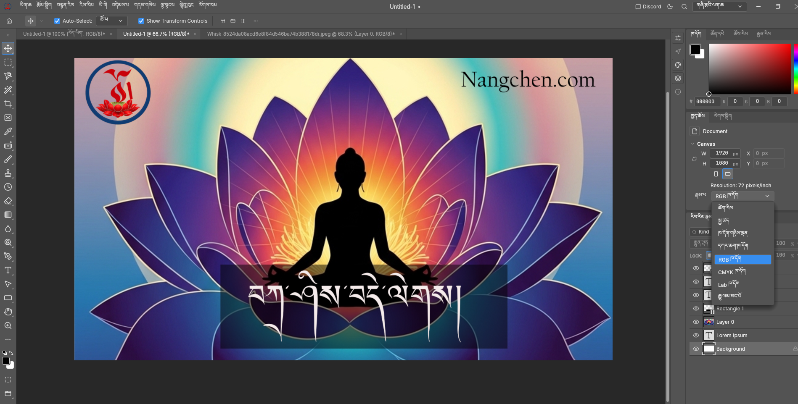
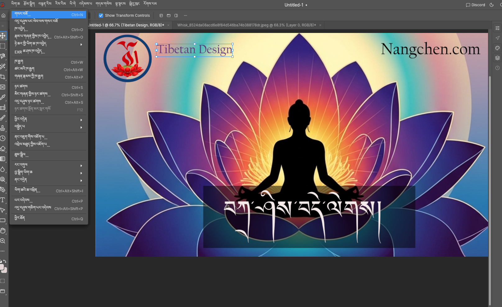
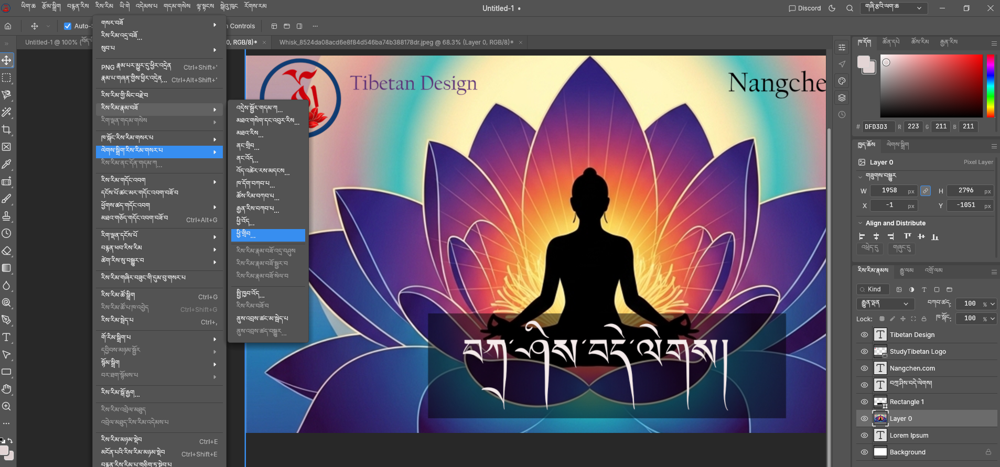
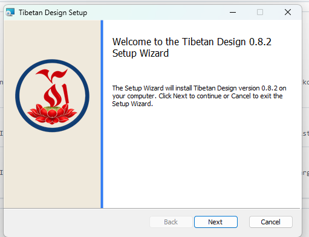
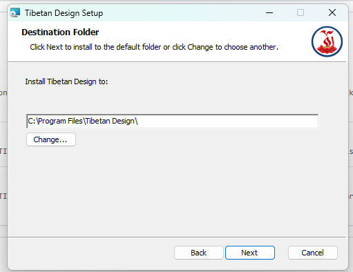
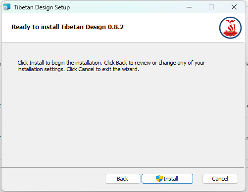
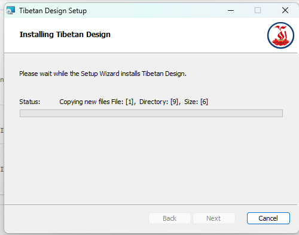
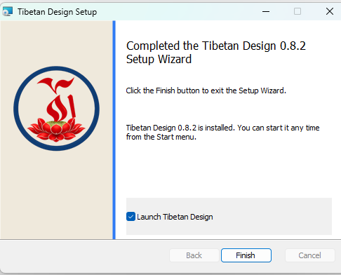

<p align="center">
  
</p>

<h1 align="center">Tibetan Design</h1>

<p align="center">
  A native image editor with Tibetan and English menus and tools.
</p>

## Screenshots



*Tibetan Design running on Windows with Tibetan menus and Tibetan text in an image project.*


*The Tibetan File menu with keyboard shortcuts, alongside artwork and an editable text layer.*



*Tibetan layer menus alongside text, logo and artwork layers in the Layers panel.*

<details>
<summary><strong>Windows installation screenshots</strong></summary>

### 1. Welcome



### 2. Choose the installation folder



### 3. Ready to install



### 4. Installation in progress



### 5. Finish and launch



</details>

## Create and edit

Tibetan Design brings image editing tools into a Tibetan and English interface, with layers, masks, brushes, text, adjustments and PSD support inherited from its original editing engine.

- Switch between Tibetan and English using **Edit → Language**.
- Use Tibetan names for your layers and documents.
- Work with layers, masks, selections, brushes and text.
- Open PSD files and save editable projects in the native `.pcraft` format.

Tibetan menus and tools are translated. Some descriptions, errors and status messages still use English. See the [Tibetan terminology and review notes](docs/localization-bo.md) for coverage and review limitations.

## Download for Windows

Visit [Tibetan Design on Nangchen.com](https://nangchen.com/tibetan-design) for the Windows download and application information.

Repository maintainers can also download build artifacts:

1. Open [Tibetan Design Windows builds](https://github.com/tibetanebook-cloud/tibetan-design/actions/workflows/tibetan-design-windows.yml).
2. Select a successful run with a green checkmark.
3. Download the **Tibetan-Design-Windows** artifact.
4. Extract the downloaded ZIP.
5. Open **`tibetan-design-0.8.2-windows-x64.msi`** to install, or extract the portable ZIP to run without installing.

Artifact downloads from this private repository require a GitHub account with repository access. Packages built without signing credentials are unsigned and remain subject to Windows security checks.

## Language

**English:** Edit → Language → English

**Tibetan:** Edit → Language → བོད་ཡིག · Tibetan

In Tibetan, the menu path is **རྩོམ་སྒྲིག → སྐད་ཡིག**.

## Build and contribute

See [Tibetan Design build instructions](TIBETAN-DESIGN.md) for Windows prerequisites and the GitHub Actions build workflow.

Translation sources are in `tibetan-terms.txt` and `tibetan-context-terms.txt`. Rebuild the embedded catalog after editing them:

```powershell
./scripts/build-tibetan-catalog.ps1
cargo test -p photocraft-ui-egui --lib i18n:: --locked
```

See [development](docs/development.md), [architecture](docs/architecture.md) and [contributing](docs/contributing.md) for the editing engine and development conventions.

## More Tibetan apps and resources

Explore more apps and resources at:

- [Nangchen.com](https://nangchen.com)
- [StudyTibetan.com](https://studytibetan.com)
- [TibetanEbook.com](https://tibetanebook.com)

## Attribution and licenses

Tibetan Design is a customization of [PhotoCraft](https://github.com/storytold/photocraft). Copyright (c) 2026 ArtCraft Team and the PhotoCraft contributors. Original contributor credits and required notices are retained.

The inherited code is licensed under [MIT](LICENSE-MIT) or [Apache-2.0](LICENSE-APACHE). See [NOTICE](NOTICE) and [asset attribution](ATTRIBUTION.md) for third-party notices and asset licenses. The supplied Tibetan Design logo and terminology reference do not acquire a public license through these code licenses.
